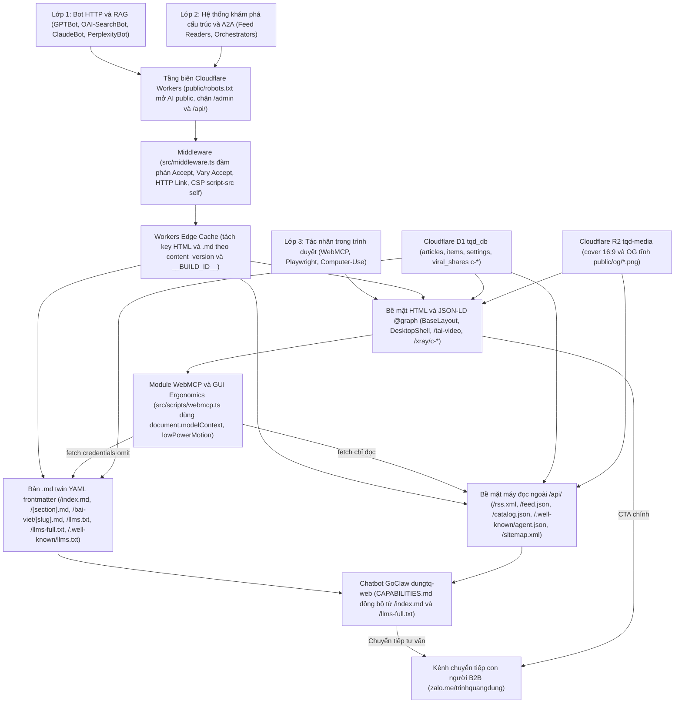

# Kế hoạch tổng thể nâng cấp SEO, GEO, trải nghiệm Agent và nội dung cho tqd.me

Tài liệu này tổng hợp kết quả kiểm toán trực tiếp trên `https://tqd.me`, bản thiết kế kiến trúc trải nghiệm tác nhân AI (Agent Experience) và lộ trình nội dung chuẩn Agent-Index thành một kế hoạch điều hành thống nhất cho dự án `/Volumes/2/TQD-Website`. Mọi đề xuất đều bám sát nền tảng sẵn có của website gồm Astro `^7.3.8` SSR trên Cloudflare Workers (`@astrojs/cloudflare`), Tailwind CSS v4, TypeScript 6, D1 (`tqd_db`) và R2 (`tqd-media`), dưới định danh chính chủ **Trịnh Quang Dũng (DũngTQ)** và kênh chuyển đổi B2B chính `https://zalo.me/trinhquangdung`.

Kế hoạch hợp nhất dữ liệu kiểm chứng ngày `15/11/2026` (`x-content-version: 105`) từ ba báo cáo chuyên ngành (`01-audit-seo-geo-live.md`, `02-ke-hoach-phat-trien-website-ax.md`, `03-ke-hoach-content-agent-index.md`) cùng các ràng buộc bảo mật, hiệu năng và khả năng tiếp cận tại `REVIEW.md`.

---

## Phần 1 - Tóm tắt điều hành và bảng điểm hiện trạng SEO-GEO-AX của tqd.me

Kết quả kiểm tra trực tiếp trên production cho thấy `tqd.me` đạt **7.6 / 10** qua 7 nhóm tiêu chí. Lệnh quét `check-discovery-surfaces.mjs https://tqd.me --sample 15 --json` thoát mã `0` với `0` error và `0` warning trên `15` mẫu trích từ `28` URL của `sitemap.xml`, chỉ ghi nhận `1` ghi chú mức `info` tại mục `ai-crawlers`. Toàn bộ 3 điểm tồn đọng từ tài liệu ngày `04/11/2026` gồm dòng tóm tắt bài viết trong `/llms.txt` (`src/lib/profile-markdown.ts:154`), ảnh `og:image` lấy theo `coverKey` (`src/pages/bai-viet/[slug].astro:38-40,53`) và thuộc tính `alt={article.title}` trên ảnh bìa (`src/pages/bai-viet/[slug].astro:114`) đều đã hoạt động trên bản live.

### Nền tảng kỹ thuật đã vận hành ổn định

- **Mở cửa crawler và không bị WAF chặn:** `public/robots.txt` (`200`, `968` B) mở quyền cho `*` cùng 10 bot AI và chặn `/admin`, `/api/`. Khi gửi thử nghiệm `User-Agent` của `OAI-SearchBot`, `ClaudeBot`, `PerplexityBot`, `ChatGPT-User`, `Claude-SearchBot` và `GPTBot`, cả 6 bot đều nhận HTTP `200` (`cf-cache-status: HIT`), không gặp challenge hay `cf-mitigated`.
- **Đàm phán Markdown và tách key cache đúng chuẩn:** `src/middleware.ts:373-431` xử lý `prefersMarkdown()` trước khi tra cứu `caches.open('pages')` và gọi `context.rewrite(mdTwin)`. Nhờ đó, yêu cầu `Accept: text/markdown` trả về `200`, `Content-Type: text/markdown; charset=utf-8`, `Vary: Accept` và `X-Robots-Tag: noindex`, còn key cache theo `content_version` và `__BUILD_ID__` tách riêng hai phiên bản HTML và `.md`.
- **Hệ thống điều hướng và tiện ích đọc AI:** Các tên miền phụ (`www.tqd.me`, `tqd.io.vn`) và tuyến cũ (`/so-lieu`, `/chuyen-mon`, `/dao-tao`) đều chuyển hướng `301` đúng đích. Thanh `PageActions.astro` đã chạy trên các trang chuyên mục và bài viết với cơ chế `ClipboardItem` `Promise<Blob>` tương thích Safari.

### Bảng điểm hiện trạng 7 hạng mục

| Hạng mục | Điểm (/10) | Hiện trạng xác minh trực tiếp | Khoảng trống cần xử lý |
| :--- | :---: | :--- | :--- |
| Crawl, Index và Redirect | **9.0** | `robots.txt` (`200`, `968` B), `sitemap.xml` (`200`, `3.033` B, `28` URL), chuyển hướng `301` chuẩn. | Chưa có bản ghi `/xray/c-*` trong `sitemap.xml`; `/video` trả `404` vì tuyến thật là `/video-ai`. |
| Đàm phán Markdown và Workers Cache | **9.0** | Đàm phán `Accept: text/markdown` trả `200` (`17.703` B tại `/`), `Vary: Accept`, cache tách key HTML và `.md`. | Thiếu HTTP `Link` header; trang `404` nhân đôi `sha256` trong CSP; `/bai-viet/non-existent` kèm `Accept: text/markdown` trả `404` `text/plain`. |
| WAF và Bot AI | **9.5** | Cả 6 bot AI thử nghiệm đều nhận HTTP `200` (`cf-cache-status: HIT`), tải nguyên vẹn nội dung. | Không bị chặn; cần chốt chủ trương giữ mở cả bot training hay phân tách nhóm bot. |
| `llms.txt`, `llms-full.txt` và Feed | **5.5** | `/llms.txt` (`11.298` B) có tóm tắt bài viết và link `.md` sống; `/search.json` (`11.669` B) phục vụ `⌘K`. | **`/llms-full.txt` (`33.168` B) rỗng sạch thân bài (`bodyMd`)**; thiếu `/.well-known/llms.txt`, `/rss.xml` và `/feed.json`. |
| Metadata, Heading và Social OG | **6.0** | Ảnh `og:image` theo `coverKey` (`17/19` bài) và `alt` ảnh bìa chạy đúng. | Sáu chuyên mục có description `16-30` ký tự; `/` (`327` ký tự) và `18/19` bài vượt `160` ký tự; `heading-order` `0` điểm; `/` có `2` thẻ `<h1>`. |
| JSON-LD `@graph` | **6.5** | `/bai-viet/[slug]` (`Article`) và `/tai-video` (`WebApplication`) đủ schema cốt lõi. | Năm chuyên mục (`/san-pham`, `/video-ai`, `/bai-viet`, `/thu-vien`, `/lien-he`) và `/xray/[id]` thiếu node chuyên biệt; `/` thiếu `ProfilePage`. |
| `PageActions` và Trải nghiệm Agent | **8.0** | `PageActions.astro` hỗ trợ chép Markdown, mở AI trên các trang con và bài viết. | Trang chủ `/` chưa gắn `PageActions`; tham số query tới Perplexity và ChatGPT ở `PageActions.astro:15,17` chưa khớp mẫu mới. |

### Điểm nghẽn Must và Should cần xử lý ngay

| Mức độ | Hạng mục và vị trí mã nguồn | Tác động thực tế đã đo | Hướng xử lý chốt |
| :---: | :--- | :--- | :--- |
| **MUST** | **Khôi phục thân bài `/llms-full.txt`** (`src/pages/llms-full.txt.ts:6-9`, `src/lib/content.ts:230-231,262`) | `listArticles()` gán `'' AS body_md` khiến `33.168` B của `/llms-full.txt` trống toàn bộ nội dung `19` bài viết. | Thêm `listRecentArticlesWithBody(db, 12)` riêng cho `/llms-full.txt` và đặt ngưỡng tổng `120_000` ký tự. |
| **MUST** | **Sửa `heading-order` và trùng `<h1>`** (`SectionBody.astro`, `ItemCard.astro`, `ChatPanel.astro:33`, `DesktopShell.astro:26`, `MobileShell.astro:35`) | Nhảy cấp `h1 -> h3` rồi `h2` ở cuối DOM làm `.lighthouse-san-pham.json` rớt `0` điểm `heading-order`; `/` xuất `2` thẻ `<h1>`. | Đổi tiêu đề khối thành `<h2>` và card con thành `<h3>`; đổi `#chat-title` sang `<p>`; giữ `1` thẻ `<h1>` duy nhất tại `/`. |
| **MUST** | **Chuẩn hóa `<title>` và `<meta description>`** (`src/pages/[section].astro:38`, `src/pages/index.astro:16`, dữ liệu D1) | Mô tả 6 chuyên mục chỉ dài `16-30` ký tự (`s.short`); `/` dài `327` ký tự; `18/19` bài vượt `160` ký tự (tối đa `350` ký tự). | Cấp `seoTitle` (`45-60` ký tự) và `seoDescription` (`130-155` ký tự) cho 6 chuyên mục; rút snippet `/` và bài viết về `140-158` ký tự. |
| **MUST** | **Bổ sung JSON-LD `@graph` đầy đủ** (`src/lib/structured-data.ts`, `BaseLayout.astro:72-79`, `[section].astro:29-32`, `xray/[id].astro:67-77`) | Năm trang danh mục thiếu schema loại nội dung; `/` thiếu `ProfilePage`; `/xray/[id]` thiếu `TechArticle`. | Bổ sung `CollectionPage` + `ItemList` (`SoftwareApplication`, `VideoObject`, `Blog`, `ImageGallery`, `ContactPage`), `ProfilePage` ở `/`, `TechArticle` ở `/xray/[id]`, không dùng `FAQPage`/`HowTo`. |
| **MUST** | **Bảo vệ `/xray/c-*` khỏi xóa nhầm** (`src/lib/viral.ts:708`) | Cron `cleanupViralCache` xóa mọi `viral_shares` quá 30 ngày, chưa loại trừ bản tuyển chọn `c-*`. | Sửa câu lệnh SQL thành `DELETE FROM viral_shares WHERE created_at < ?1 AND share_id NOT LIKE 'c-%'`. |
| **SHOULD** | **Phát HTTP `Link` header và mở endpoint chuẩn** (`src/middleware.ts:171-191`, `profile-markdown.ts:205-207`, `src/pages/.well-known/`) | HTML và `.md` chưa trả HTTP `Link` header; `/.well-known/llms.txt`, `/rss.xml`, `/feed.json` trả `404` và nhân đôi hash CSP `404`. | Gắn `Link` (`rel="llms-txt"`, `rel="alternate"; type="text/markdown"`, `rel="canonical"`) trước `cache.put`; vá trùng hash `404` tại `withHtmlInlineScriptHashes` (`src/middleware.ts:197-243`). |
| **SHOULD** | **Gắn `PageActions` lên `/` và dọn chỉ dẫn trích dẫn** (`src/pages/index.astro`, `PageActions.astro:15,17`, `SectionBody.astro:116-133`) | `/` thiếu thanh tiện ích AI; `/san-pham.md` thiếu thẻ `/tai-video`; `/video-ai` và `/thu-vien` mù chữ với bot. | Gắn `PageActions` trên `/`; cập nhật query URL AI; bổ sung `/tai-video` vào `/san-pham.md`; thêm transcript và luận điểm cho `/video-ai`, `/thu-vien`. |

---

## Phần 2 - Sơ đồ kiến trúc đích tối ưu cho 3 lớp Agent

Kiến trúc mới giữ nguyên nguyên tắc không xây lại từ đầu và tránh bốn bẫy kỹ thuật đã nhận diện: mọi điểm cuối công khai (`/rss.xml`, `/feed.json`, `/catalog.json`, `/.well-known/llms.txt`, `/.well-known/agent.json`) đặt ngoài `/api/` để không đụng `Disallow: /api/` trong `public/robots.txt`; giữ nguyên mảng JSON cấp một của `/search.json` cho hộp thoại `⌘K` (`src/scripts/command-palette.ts`); không tạo `@id` treo trong JSON-LD hay gắn `FAQPage`/`HowTo`; và chỉ dùng `document.modelContext` (WebMCP chuẩn mới) kèm danh sách trắng đường dẫn để chặn Indirect Prompt Injection từ dữ liệu khách trên `/xray/`.



---

## Phần 3 - Ma trận ưu tiên phát triển website 3 giai đoạn

Toàn bộ phần phát triển kỹ thuật được chia thành 3 giai đoạn kế tiếp nhau, ưu tiên vá dứt điểm lỗi thu thập dữ liệu và SEO cốt lõi trước khi mở feed cấu trúc và tương tác WebMCP trong trình duyệt.

| Giai đoạn và thời lượng | Hạng mục kỹ thuật trọng tâm | Tệp mã nguồn đích | Thay đổi chính cần thực thi | Tiêu chí thoát giai đoạn |
| :--- | :--- | :--- | :--- | :--- |
| **Giai đoạn 1** (1-2 ngày): HTTP, Markdown và SEO kỹ thuật | 1. Vá `/llms-full.txt` và nén mật độ token `/llms.txt`<br>2. Chuẩn hóa YAML frontmatter và `updated` ISO 8601 UTC trên `.md` twins<br>3. Phát HTTP `Link` headers và mở `/.well-known/llms.txt`<br>4. Vá trùng hash CSP `404`, `heading-order`, trùng `<h1>`, metadata và JSON-LD `@graph` | `src/lib/content.ts`, `src/pages/llms-full.txt.ts`, `src/lib/profile-markdown.ts`, `src/pages/*.md.ts`, `src/scripts/page-actions.ts`, `src/middleware.ts`, `src/pages/.well-known/llms.txt.ts`, `src/layouts/BaseLayout.astro`, `src/lib/structured-data.ts`, `src/pages/index.astro`, `src/pages/[section].astro`, `src/pages/tai-video.astro`, `src/pages/xray/[id].astro`, `src/components/SectionBody.astro`, `ItemCard.astro`, `ChatPanel.astro`, `DesktopShell.astro`, `MobileShell.astro`, `PageActions.astro`, `scripts/verify/site.mjs` | Thêm `listRecentArticlesWithBody(db, 12)` cho `/llms-full.txt` kèm mục lục neo và trần `120_000` ký tự; thêm 8 sản phẩm nổi bật và link Machine Discovery vào `/llms.txt`; dùng `renderFrontmatter()` (`JSON.stringify`) và `lastModifiedIso()`; append HTTP `Link` trước `cache.put`; dựng `/.well-known/llms.txt` (`200`); sửa nhảy `h1 -> h3 -> h2` và bỏ `<h1>` kép tại `/`; cấp `seoTitle` (`45-60` ký tự), `seoDescription` (`130-155` ký tự) cho 6 chuyên mục và rút snippet bài viết về `140-158` ký tự; bảo đảm `#person` luôn tồn tại trong `@graph` và thêm `CollectionPage`/`ItemList`, `ProfilePage`, `TechArticle`; chuyển hướng `301` `/video` sang `/video-ai` và gắn `PageActions` lên `/`. | `npx astro check`, `npm test`, `npm run check:privacy`, `npm run build` pass; `scripts/verify/site.mjs` pass; `/llms-full.txt` có đủ thân bài gần nhất; `curl -sI` thấy HTTP `Link` và 1 hash CSP trên `404`; `/.well-known/llms.txt` trả `200`; Lighthouse `heading-order` đạt chuẩn (`1` `<h1>` trên `/`). |
| **Giai đoạn 2** (3-5 ngày): Feeds, Public Catalog và A2A Agent Card | 1. Mở `/rss.xml` (RSS 2.0) và `/feed.json` (JSON Feed 1.1)<br>2. Mở danh mục máy đọc `/catalog.json` và giữ nguyên `/search.json`<br>3. Mở `/.well-known/agent.json` (A2A Agent Card)<br>4. Khóa an toàn `c-*` trong cron D1 | `src/lib/feeds.ts`, `src/pages/rss.xml.ts`, `src/pages/feed.json.ts`, `src/lib/feeds.test.ts`, `src/lib/catalog.ts`, `src/pages/catalog.json.ts`, `src/lib/catalog.test.ts`, `src/lib/agent-card.ts`, `src/pages/.well-known/agent.json.ts`, `src/lib/agent-card.test.ts`, `src/lib/viral.ts:708`, `src/lib/analytics/normalize.ts`, `public/robots.txt`, `src/layouts/BaseLayout.astro`, `scripts/verify/site.mjs` | Tạo feed XML/JSON tại root domain ngoài `/api/`, escape XML và lọc URL ảnh `coverKey`; mở `/catalog.json` (`items` gồm `article`, `product`, `video`, `tool`, `showcase`, lọc `links[]` chỉ giữ `http:`/`https:`, cấp CORS chỉ đọc `GET/HEAD/OPTIONS` cho 4 endpoint công khai mới) trong khi giữ nguyên mảng phẳng của `/search.json` cho `command-palette.ts`; đọc sản phẩm từ D1 và hạn mức public thật từ `chat.ts`, `dl.ts`, `viral.ts` vào `agent.json` kèm `webOnlyExecution: true` và Zalo B2B (không lộ URL nội bộ hay quyền admin); sửa `viral.ts:708` thêm `AND share_id NOT LIKE 'c-%'`. | Bộ test mới (`feeds.test.ts`, `catalog.test.ts`, `agent-card.test.ts`) và `site.mjs` pass; `curl -sf` và `jq` xác nhận 5 điểm cuối mới trả `200`, đúng schema; `⌘K` tìm kiếm bình thường; test xác nhận `cleanupViralCache` không xóa bản ghi `c-*`. |
| **Giai đoạn 3** (1-2 tuần): WebMCP `document.modelContext` và GUI Agent Ergonomics | 1. Tích hợp `webmcp.ts` tuân thủ CSP `script-src 'self'`<br>2. Giảm chồng lấp cửa sổ và tải CPU nền trên Desktop `/` khi chạy bot<br>3. Chuẩn hóa ARIA cho `/tai-video` và `ChatPanel`<br>4. Tối ưu ảnh bìa R2 offline (Could) và đo lại Lighthouse | `src/lib/webmcp-tools.ts`, `src/scripts/webmcp.ts`, `src/lib/webmcp-tools.test.ts`, `src/layouts/BaseLayout.astro`, `src/components/DesktopShell.astro`, `src/scripts/desktop.ts`, `src/scripts/motion.ts`, `src/scripts/wallpaper.ts`, `src/scripts/featured-video.ts`, `src/scripts/weather.ts`, `src/scripts/mascot.ts`, `src/pages/tai-video.astro`, `src/scripts/tai-video.ts`, `src/scripts/viral-lab.ts`, `src/components/ChatPanel.astro`, `src/scripts/chat-panel.ts`, ảnh tĩnh R2 (`tqd-media`) | Dùng duy nhất `document.modelContext`, import qua Astro bundle (0 inline JS); đăng ký 4 tool toàn site (`search_tqd_knowledge`, `read_markdown_page` với `SAFE_PATH_RE` + `credentials: 'omit'`, `list_ai_products`, `get_contact_info`) + 1 tool theo route (`open_desktop_section` trên `/`, `prefill_tai_video` trên `/tai-video`), mọi `ToolAnnotations` chỉ dùng `readOnlyHint`, `untrustedContentHint`, `consequentialHint`; hỗ trợ `/?window=<section>`, `/?layout=focus`, `lowPowerMotion()` tắt `silk-wallpaper.mp4`/canvas/linh vật khi `navigator.webdriver === true`; thêm `<label>` cho `#dl-input-batch`, `role="progressbar"` cho `#dl-progress-bar`, `aria-live="polite"` cho 4 trạng thái `/tai-video`; sửa `chat-panel.ts:270,320-321` không ẩn `pending` bằng `aria-hidden="true"` trong lúc stream SSE; nén ảnh bìa `1,45` MB và thêm `coverKey` cho 2 bài cũ (`< 300` KB). | `validate_webmcp.mjs --strict` pass trên cả `webmcp.ts` và `webmcp-tools.ts`; `render-check.mjs` đạt `0` cảnh báo `small-touch-target` và `0` lỗi console/CSP trên `/`, `/tai-video`, `/ho-so`; test Playwright xác nhận `navigator.webdriver` dừng video/canvas nền và cây Accessibility đọc được `ChatPanel` khi đang stream. |

---

## Phần 4 - Lộ trình Content chuẩn Agent-Index 8 tuần

### Đối chiếu dữ liệu live và điểm nghẽn trích dẫn

Tính tới ngày `15/11/2026`, D1 (`tqd_db`) đang phát hành **19 bài viết** (tổng `34.199` từ trên 19 bản `.md`), gồm **2/13 bài** trong `plans/seo-aeo-queue.json` (bài Hub `tu-dien-ai-agent-cho-nguoi-khong-biet-lap-trinh` và bài `1.1` `ai-agent-khac-gi-chatbot`), **10 bài nền tảng** tháng 10-04/11 và **7 bài mới** ngày 11-13/11 (`6` bài showcase sản phẩm + `1` bài tin NVIDIA). Còn **11/13 bài** trong queue (`1.2` tới `4.3`) chưa viết. Sản phẩm `Opus Video` và bài `opus-video-skill-lam-video-tieng-viet` đã xóa khỏi D1 ngày `11/11/2026` (`plans/261111-showcase-san-pham/upsert-products.sql:9-10`), nhưng `plans/seo-aeo-queue.json` và `/ho-so.md` vẫn còn nhắc tên.

Kiểm toán khả năng trích dẫn trên 5 bề mặt nội dung cho thấy bốn đứt gãy lớn: chỉ `2/19` bài giữ mở đầu ngắn `40-60` từ (các bài khác dài `70-120` từ); chỉ `7/19` bài có bảng Markdown (`12/19` bài còn lại thiếu bảng); `8/19` bài bị mồ côi (`0` inbound link), `11/19` bài có `0` outbound link và `0/19` bài trỏ link trong thân bài về `/san-pham`, `/tai-video` hay `/ho-so`; phần thân dưới `## H2` hay xưng `"mình"` nên khi RAG cắt tách chunk sẽ rơi mất tên **Trịnh Quang Dũng (DũngTQ)** và **ABM**. Ở các thực thể còn lại, `/san-pham` có `8` mục D1 nhưng thẻ `/tai-video` hardcode trong `SectionBody.astro:116-133` lại thiếu trong `/san-pham.md`; `/video-ai` có `7` video TikTok mô tả `5-24` từ và `0` transcript; `/thu-vien` mới có `4` mục (thiếu minh chứng BSR, ABIC, Hanoitourist); `/xray/c-*` có `0` trang trong `sitemap.xml`; `/so-lieu` đang `301` về `/`.

### Tiêu chuẩn khối tri thức cho 5 thực thể (Agent-Citable Spec)

- **Bài viết (`/bai-viet/[slug]` HTML và `.md`):** Mỗi bài đạt 6 cấu phần: (1) Answer Capsule `40-60` từ đứng độc lập ngay đầu bài; (2) tối thiểu `60%` tiêu đề `## H2` dạng câu hỏi/bài toán thực tế (tận dụng `injectHeadingIdsAndToc` ở `src/lib/toc.ts:47`), mỗi mục `## H2` dài `180-320` từ; (3) ít nhất `1` bảng đối chiếu Markdown `3-4` cột; (4) số liệu VNĐ/USD thực tế kèm quy tắc thực hành gắn tên **Trịnh Quang Dũng (DũngTQ)** hoặc **ABM** trong chính thân mục `## H2`; (5) khối *Khi nào dùng và khi nào không dùng*; (6) tối thiểu `2` link sang bài Hub/liên quan và `1` link về `/san-pham`, `/tai-video` hoặc `/ho-so` đặt ngay trong `bodyMd` (không lặp lại ảnh bìa `coverKey` trong `bodyMd` vì `bai-viet/[slug].astro:112` đã tự hiển thị).
- **Sản phẩm và Skill (`/san-pham` và `.md`):** Chuẩn hóa phần `summary` trong ngưỡng `<= 1000` ký tự của D1 (`docs/admin-agent-operations.md:205`) theo 5 lớp (*Bài toán - Đối tượng - Cơ chế - Kết quả đo lường thực tế - Đường dẫn kép* gồm link chạy thử và link bài viết sâu); cấp `coverKey` 16:9 cho `Viết Pro` và `TQD-Clean Your Mac`; thêm thẻ dịch vụ tư vấn AI Agent B2B gắn CTA `https://zalo.me/trinhquangdung`; đưa `/tai-video` vào dữ liệu xuất `/san-pham.md`.
- **Video AI và Thư viện (`/video-ai`, `/thu-vien`):** Mỗi mục trên `/video-ai` có 4 phần (*1 câu bài toán + 3 luận điểm chính + tóm tắt lời thoại 80-120 từ + link bài viết/sản phẩm liên quan*), xếp nhóm video ứng dụng SME lên trên 3 video nhạc AI (`10/2025`). Mỗi mục `/thu-vien` dùng công thức caption `[Đơn vị đối tác] - [Tên chương trình và Thời gian/Địa điểm] - [Nội dung thực hành và Đầu ra]`, bổ sung tóm tắt video Agribank (`agribank-dao-tao-ai.mp4`) và tối thiểu `3` tư liệu của **BSR**, **ABIC**, **Hanoitourist**, đi kèm schema `VideoObject` / `ImageObject`.
- **Xưởng kịch bản viral tuyển chọn (`/xray/c-*`):** Áp dụng Programmatic GEO cho 8 ngành (*Đào tạo AI, F&B, Bất động sản, Thời trang/TMĐT, Mỹ phẩm/Làm đẹp, Khóa học, Sức khỏe, SaaS/B2B*) khi `vietProScore >= 95/100`. Mỗi trang gồm tiêu đề theo ngành, bảng chấm điểm hook X/100, kịch bản chuyển thể tiền tệ VNĐ và link ngược `/tai-video`, `viet-pro`, Zalo B2B. Bản ghi khách không có tiền tố `c-` giữ nguyên `noindex, nofollow` và tước link ngoài theo `REVIEW.md`.
- **Hồ sơ và thực chứng E-E-A-T (`/ho-so` và `.md`):** Không mở lại `/so-lieu` mà gộp toàn bộ bằng chứng vào `/ho-so`: gỡ `Opus Video` khỏi `person.intro`, bổ sung khối *Năng lực thực chứng* (10 năm CEO xuất nhập khẩu Trung - Việt, đào tạo AI toàn thời gian từ đầu 2025, đối tác BSR, Agribank `15-16/06/2026`, ABIC, Hanoitourist, Vina2 dẫn sang `/thu-vien`, hệ `8` sản phẩm D1 + `/tai-video`, lộ trình bài viết `19 -> 35`), đồng thời thêm `worksFor` (`Công ty Cổ phần Công nghệ và Đào tạo ABM`, `https://lp.abmedu.vn`) vào `personNode` (`src/lib/structured-data.ts:11-26`).

### Ma trận 4 trụ cột nội dung (35 bài viết + trang thực thể)

| Trụ cột nội dung | Điểm neo chính | Bài đã live (`19` bài) | Bài tồn `seo-aeo-queue.json` (`11` bài) | Bài khoảng trống 2026 (`5` bài) |
| :--- | :--- | :--- | :--- | :--- |
| **1. Nhân sự số và Agentic Workflow cho SME** | `/bai-viet/tu-dien-ai-agent-cho-nguoi-khong-biet-lap-trinh` | Hub + `ai-agent-khac-gi-chatbot`, `chatgpt-chat-work-codex...`, `ban-tin-ai-agent-nua-cuoi-thang-10-2026`, `jensen-huang...` (`5` bài) | `2.1` `prompt-khac-gi-skill...`, `2.2` `mcp-va-api...`, `2.3` `ao-giac-ai...`, `2.4` `computer-use...`, `4.2` `multi-agent...`, `4.3` `human-in-the-loop...` (`6` bài) | `agentic-workflow-cho-sme-theo-phong-ban`, `webmcp-va-website-chuan-agent-ready` (`2` bài) |
| **2. Công cụ, chi phí và ROI nhân sự số** | `/bai-viet/chon-cong-cu-ai-theo-dau-viec-cho-ceo` | Hub + `chi-phi-ai-theo-tung-nhan-vien...`, `claude-doi-ten-goi-max...` (`3` bài) | `1.2` `token-va-context-window-la-gi`, `1.3` `model-suy-luan...`, `4.1` `api-key-tep-env...` (`3` bài) | `chi-phi-va-roi-nhan-su-so-cho-sme` (`1` bài) |
| **3. Vibe Code, sản phẩm thực chiến và hạ tầng biên** | `/san-pham` và `/bai-viet/cloudflare-cho-nguoi-moi-vibe-code` | `cloudflare...`, `github-co-ban...`, `claude-design...`, `tqd-clean-your-mac...` + `6` bài showcase phần mềm (`10` bài) | `3.1` `vibe-code-la-gi...`, `3.2` `frontend-backend-database-la-gi` (`2` bài) | *(Gắn `6` bài giới thiệu phần mềm vào cụm `3.1` và `3.2` làm dẫn chứng thực tế)* |
| **4. Tự động hóa nội dung, chống văn mẫu và Video/Media** | `/tai-video` và `/bai-viet/viet-pro-skill-viet-tieng-viet-cho-ai` | `viet-pro-skill-viet-tieng-viet-cho-ai` (`1` bài) + `/tai-video` + `/video-ai` + `/xray/c-*` | *(Hết bài tồn sau khi `opus-video` bị xóa ngày 11/11)* | `he-thong-chong-van-mau-ai-tieng-viet`, `tu-dong-hoa-san-xuat-video-media-bang-ai` (`2` bài) |

### Lộ trình triển khai 4 Sprint x 2 tuần

| Đợt Sprint | Bài viết mới (16 bài) | Nâng cấp thực thể và hồi tố liên kết | Chỉ tiêu hoàn thành (DoD) |
| :--- | :--- | :--- | :--- |
| **Sprint 1** (Tuần 1-2) | `1.2` `token-va-context-window-la-gi`, `2.1` `prompt-khac-gi-skill-trong-ai-agent` (thay tham chiếu `opus-video` thành `viet-pro` và `/tai-video`), `2.2` `mcp-va-api-la-gi-cho-nguoi-khong-biet-code` | Phối hợp dev vá `/llms-full.txt` và `viral.ts:708`; sửa Hub trỏ tới `1.1` và 3 bài Đợt 1; rút Answer Capsule bài `1.1` về `40-60` từ + link `/san-pham`; hồi tố `4` bài SME cũ (`chon-cong-cu`, `chi-phi`, `chatgpt-chat-work-codex`, `claude-design`). | 3 bài Đợt 1 lên sóng; `/llms-full.txt` xuất 100% thân bài gần nhất; giảm bài thiếu outbound link từ `11` xuống `7`. |
| **Sprint 2** (Tuần 3-4) | `2.3` `ao-giac-ai-hallucination-va-rag-la-gi`, `3.1` `vibe-code-la-gi-cho-nguoi-khong-biet-lap-trinh`, `4.1` `api-key-tep-env-va-tran-chi-tieu-ai`, `1.3` `model-suy-luan-khac-gi-model-chat-nhanh` | Nâng cấp 8 mục `/san-pham` theo khung 5 lớp (thêm `coverKey` 2 công cụ cũ, thẻ B2B, đưa `/tai-video` vào `/san-pham.md`); hồi tố `6` bài trình diễn sản phẩm vừa đăng; cập nhật `/ho-so` (gỡ `Opus Video`, thêm *Năng lực thực chứng*). | Xóa sạch `8/19` bài mồ côi (`0` orphan); 100% `/san-pham` đạt chuẩn gợi ý AI. |
| **Sprint 3** (Tuần 5-6) | `3.2` `frontend-backend-database-la-gi`, `2.4` `computer-use-va-browser-agent-la-gi`, `4.2` `multi-agent-dieu-phoi-nhieu-agent-la-gi`, `4.3` `human-in-the-loop-diem-dung-duyet-tay` | Hồi tố 4 bài còn lại (`github-co-ban`, `viet-pro`, `tqd-clean-your-mac`, `cloudflare`); nâng cấp `7` mục `/video-ai` (luận điểm + transcript + link); bổ sung transcript Agribank và tư liệu `BSR`, `ABIC`, `Hanoitourist` cho `/thu-vien`. | Đạt **13/13 bài** `seo-aeo-queue.json`; 100% bài cũ đạt Agent-Citable Spec; `/video-ai.md` và `/thu-vien.md` đầy đủ ngữ nghĩa. |
| **Sprint 4** (Tuần 7-8) | `agentic-workflow-cho-sme-theo-phong-ban`, `webmcp-va-website-chuan-agent-ready`, `chi-phi-va-roi-nhan-su-so-cho-sme`, `he-thong-chong-van-mau-ai-tieng-viet`, `tu-dong-hoa-san-xuat-video-media-bang-ai` + **8-10 trang `/xray/c-*`** | Gắn danh sách `/xray/c-*` tuyển chọn lên `/tai-video` và chèn ví dụ vào 2 bài Trụ cột 4; kiểm tra chéo liên kết toàn bộ 35 bài. | Đạt **35 bài viết** + **8-10 trang `/xray/c-*`** index trong `sitemap.xml` và đồng bộ Chatbot GoClaw. |

### SOP xuất bản 6 bước và đồng bộ GoClaw Agent DũngTQ

1. **Soạn chuẩn Agent-Citable Spec:** Đủ 6 thành phần cấu trúc bài viết và ảnh bìa 16:9 dưới `10` MB có `alt` rõ nghĩa.
2. **Chạy cổng biên tập Viết Pro:** Chạy `lint-vietnamese-content.mjs` (`0 ERROR`, dọn `WARN`) và gọi `gemini-decisions.audit_viet_pro_gate` đạt `gate_passed: true` với `rhythm_score_0_to_3 >= 2.0` (tối đa 2 vòng sửa; ghi `"chưa chấm gate"` nếu MCP mất kết nối).
3. **Xuất bản an toàn:** Dùng `skills/tqd-publish/scripts/tqd-publish.mjs` (`/api/v1`) cho bài viết và ảnh (kiểm tra `fbOverlap: false`, script tự khóa `If-Match`); với mục phi bài viết trên `/admin`, luôn chạy `POST /admin/sao-luu` trước rồi đọc-trộn-gửi đủ trường (giữ `visible=on` và `tiktokUrl`); tạo `/xray/c-*` bằng phiên Admin trên `/tai-video`.
4. **Kiểm chứng live:** Xác nhận HTTP `200`, thẻ `<link rel="alternate" type="text/markdown">`, `Vary: Accept`, JSON-LD và kiểm tra sự xuất hiện trong `/llms.txt`, `/llms-full.txt`, `/sitemap.xml`, `/search.json`.
5. **Đồng bộ GoClaw `dungtq-web`:** Chạy `node D:/Goclaw/plans/261013-dungtq-web/sync-context.mjs` trên máy GoClaw (`https://goclaw.tqd.io.vn`) để làm mới `CAPABILITIES.md` từ `/index.md` và toàn văn bài viết, sau đó chạy `node D:/Goclaw/plans/261013-dungtq-web/verify-chat.mjs` yêu cầu `ALL PASS`.
6. **Theo dõi định kỳ:** Rà soát `/admin/thong-ke` và `/admin/chat` hằng tuần (chỉ đếm lưu lượng và nhóm câu hỏi, không lưu tin nhắn thô theo `docs/chatbot.md:16`) để bổ sung Answer Capsule vào Sprint kế tiếp.

---

## Phần 5 - Danh sách quyết định mở cần chủ website phê duyệt

Trước khi viết code Giai đoạn 1 và khởi chạy Sprint 1, chủ website **Trịnh Quang Dũng (DũngTQ)** cần chốt 4 quyết định sau:

| Hạng mục cần quyết định | Hiện trạng xác minh | Phương án lựa chọn | Đề xuất khuyến nghị |
| :--- | :--- | :--- | :--- |
| **1. Chính sách bot training so với bot tìm kiếm AI trong `public/robots.txt`** | Đang mở cho cả 10 bot AI (`OAI-SearchBot`, `ChatGPT-User`, `Claude-SearchBot`, `Claude-User`, `PerplexityBot` và `GPTBot`, `ClaudeBot`, `Google-Extended`, `Applebot-Extended`, `CCBot`). | **A:** Giữ mở cả 10 bot để tăng tối đa tần suất AI nhắc tới DũngTQ và `tqd.me`.<br>**B:** Chỉ mở nhóm bot tìm kiếm/trích xuất thời gian thực, chặn `GPTBot`, `CCBot`, `Google-Extended` để không nạp bài chuyên sâu vào tập huấn luyện nền. | Chọn **Phương án A** cho toàn bộ tri thức công khai đã xuất bản nhằm phục vụ định vị chuyên gia, giữ ranh giới bảo vệ ở `/admin` và `/api/`. |
| **2. Phạm vi tool WebMCP GĐ3 và quyền đọc `/xray/c-*`** | `read_markdown_page` đang thiết kế mở cho các trang công khai kèm `/xray/c-*` (`untrustedContentHint: true`, chặn `/xray/` bản khách). `/xray/c-*` chứa lời thoại tóm tắt từ video bên thứ ba. | **A:** Cho phép `read_markdown_page` đọc `/xray/c-*` kèm nhãn `untrustedContentHint: true` và JSON wrapper lọc ký tự điều khiển.<br>**B:** Cô lập hoàn toàn nội dung nguồn ngoài bằng cách loại `/xray/` khỏi `SAFE_PATH_RE`, chỉ giữ các trang do DũngTQ biên soạn. | Chọn **Phương án A** kèm rà soát thủ công `vietProScore >= 95` trước khi gắn nhãn `c-*`; giữ nguyên quy tắc không tạo tool tự động bấm gửi `/api/dl/resolve` hay `/api/chat` (chỉ dùng `prefill_tai_video`). |
| **3. Xử lý thông tin `Opus Video` trong `/ho-so` và hàng đợi cũ** | `Opus Video` đã xóa khỏi D1 ngày `11/11/2026` (`upsert-products.sql:9-10`), nhưng `/ho-so.md` vẫn nhắc *"Opus Video để làm video"* và `plans/seo-aeo-queue.json` bài `2.1` còn trỏ link cũ. | **A:** Gỡ `Opus Video` khỏi `settings.person.intro` trên `/ho-so` (thay bằng `/tai-video` và bộ sản phẩm D1 hiện tại) và xóa link cũ khỏi bài `2.1`.<br>**B:** Giữ tên cũ dưới dạng mốc lịch sử sản phẩm đã ngừng phát triển. | Chọn **Phương án A** để đồng nhất D1, `/ho-so.md`, `/san-pham` và tránh việc Agent hướng dẫn khách tìm công cụ đã đóng. |
| **4. Thứ tự ưu tiên triển khai Sprint 1 và tư liệu đối tác `/thu-vien`** | `/llms-full.txt` đang rỗng thân bài và `viral.ts:708` chưa chặn xóa `c-*`; mục `/thu-vien` đang thiếu ảnh/mô tả của `BSR`, `ABIC`, `Hanoitourist`. | **A:** Chạy vá code GĐ1 (`/llms-full.txt`, `viral.ts:708`, `heading-order`, metadata, JSON-LD) trong 2 ngày đầu trước khi đẩy bài Đợt 1 (`1.2`, `2.1`, `2.2`) và đồng bộ GoClaw.<br>**B:** Đẩy bài Đợt 1 ngay trong khi giữ nguyên code cũ. | Chọn **Phương án A** để ngay khi 3 bài Đợt 1 lên sóng, `/llms-full.txt`, JSON-LD và `sync-context.mjs` nhận trọn vẹn toàn văn ngay từ đầu; đồng thời bổ sung tư liệu gốc của `BSR`, `ABIC`, `Hanoitourist` trước Sprint 3. |

---

## Phần 6 - Hợp đồng nghiệm thu và bộ lệnh kiểm chứng (DONE Contract)

Mọi thay đổi mã nguồn và nội dung trước khi hợp nhất hoặc triển khai lên Cloudflare Workers phải thỏa mãn toàn bộ cổng kiểm duyệt trong `REVIEW.md` và vượt qua chuỗi lệnh kiểm chứng sau.

### Điều kiện nghiệm thu bắt buộc theo `REVIEW.md`

- **WCAG 2.2 AA và `DESIGN.md`:** Dùng bảng màu `#faf7f1` / `#1b2030` / `#8a6420` (cấm dùng `#b8935a` cho chữ hoặc vòng `:focus-visible`); kích thước chạm trên màn hình `< 768px` đạt tối thiểu `44x44px` (`0` cảnh báo `small-touch-target`); không gắn `role="dialog"` cho `.desktop-window`; đồng bộ `role="tablist"`, `aria-expanded` và điều hướng bàn phím đầy đủ.
- **CSP `script-src 'self'` và Workers Runtime:** Cấm `<script is:inline>` chạy JavaScript (chỉ ngoại lệ `application/ld+json` thoát ký tự `<`) và cấm `onclick=`/`onerror=`/`onload=`; toàn bộ JS trình duyệt đóng gói tại `src/scripts/*.ts` theo TypeScript 6 (`HTMLElement`, `.appendChild(...)`); tuyệt đối không `import 'sharp'` trong runtime Workers (ảnh OG tĩnh sinh qua `node scripts/make-og.mjs`).
- **Bề mặt AX, SEO và Chính sách nội dung:** Duy trì bản `.md` twin 1:1 (trang `404` không phát `type="text/markdown"`), `PageActions.astro` hoạt động trên Safari, JSON-LD `@graph` không lỗi dangling `@id` và không dùng `FAQPage`/`HowTo`, mốc thời gian chuẩn ISO 8601 UTC (`toIsoUtc`). Giữ chính sách Hybrid `/xray/[id]` (bản `c-*` `index, follow` vào `sitemap.xml` và giữ link ngoài; bản khách `noindex, nofollow`, loại khỏi `sitemap.xml` và tước link ngoài trên cả HTML lẫn `.md`). Nhất quán thương hiệu **Trịnh Quang Dũng (DũngTQ)**, CTA `https://zalo.me/trinhquangdung`, văn phong Viết Pro, không emoji làm icon UI và không trùng bài Facebook (`npm run check:privacy`).

### Bộ lệnh kiểm chứng tự động (chạy tuần tự tại `/Volumes/2/TQD-Website`)

```bash
# 1. Kiểm tra kiểu Astro/TypeScript, unit test, quyền riêng tư và build (bắt buộc 0 error, 0 warning)
npx astro check
npm test
npm run check:privacy
npm run build

# 2. Khởi chạy dev server nền nếu kiểm tra cục bộ theo AGENTS.md, rồi kiểm định bề mặt & UI thật
astro dev --background
BASE="http://localhost:4321"
node /Users/tqd/.gemini/config/skills/ak-enhance-ux-ax/scripts/check-discovery-surfaces.mjs "$BASE" --site-origin https://tqd.me
node /Users/tqd/.gemini/config/skills/ak-frontend-design/scripts/render-check.mjs "$BASE"
node /Users/tqd/.gemini/config/skills/ak-frontend-design/scripts/render-check.mjs "$BASE/tai-video"
node /Users/tqd/.gemini/config/skills/ak-frontend-design/scripts/render-check.mjs "$BASE/ho-so"
node scripts/verify/site.mjs "$BASE"
```

```bash
# 3. Kiểm chứng HTTP Link, đàm phán Markdown, Feeds, Catalog và A2A Agent Card (GĐ1 và GĐ2)
curl -sI "$BASE/" | grep -iE '^(http|link|vary|x-robots-tag|content-type):'
curl -sD - -o /dev/null -H "Accept: text/markdown" "$BASE/san-pham" | grep -iE '^(http|link|vary|x-robots-tag|content-type):'
curl -sI "$BASE/khong-co-trang-nay" | grep -i 'content-security-policy'
curl -sf "$BASE/.well-known/llms.txt" | head -n 20
curl -sf "$BASE/.well-known/agent.json" | jq '{name, capabilities, escalation, skills: [.skills[].id]}'
curl -sf "$BASE/catalog.json" | jq '{schemaVersion, count: (.items | length), machineEndpoints}'
curl -sf "$BASE/feed.json" | jq '{version, count: (.items | length)}'
curl -sfI "$BASE/rss.xml" | grep -iE '^(http|content-type):'
curl -sf "$BASE/search.json" | jq 'type, length'
```

```bash
# 4. Kiểm chứng WebMCP tĩnh (GĐ3), cổng Viết Pro và đồng bộ GoClaw cho từng đợt bài viết
node /Users/tqd/.gemini/config/skills/ak-webmcp/scripts/validate_webmcp.mjs src/scripts/webmcp.ts --strict
node /Users/tqd/.gemini/config/skills/ak-webmcp/scripts/validate_webmcp.mjs src/lib/webmcp-tools.ts --strict
node /Users/tqd/.gemini/config/skills/viet-pro/scripts/lint-vietnamese-content.mjs <duong-dan-bai.md> --keep "Trịnh Quang Dũng" --keep "DũngTQ" --route-hint
/Users/tqd/.local/bin/mcporter call gemini-decisions.audit_viet_pro_gate file_path="<duong-dan-bai.md>"
# Sau khi xuất bản qua tqd-publish.mjs, chạy trên máy GoClaw:
# node D:/Goclaw/plans/261013-dungtq-web/sync-context.mjs && node D:/Goclaw/plans/261013-dungtq-web/verify-chat.mjs
```
