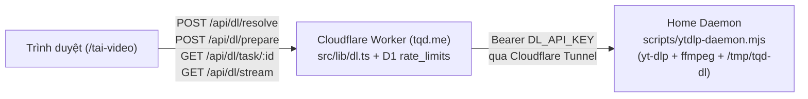

# Tính năng tải video, nhạc, playlist & profile tại `/tai-video` trên `tqd.me`

Nguồn quyết định: [brainstorm & advise report](../reports/brainstorm-261104-1708-tai-video-yt-dlp.md).

Kế hoạch này được viết theo hợp đồng bàn giao **`--advice`** (`references/advice-handover-plan.md`): mỗi phase chia thành các Task độc lập có `Goal`, `Target files and symbols`, `Steps`, `Success criteria` và lệnh `Verify` kiểm chứng cơ học; mỗi phase đều chứa khối `Failure Protocol` bắt buộc dừng và hỏi `kongming` ngay khi một lệnh `Verify` không khớp điều kiện đạt.

## Overview

Xây dựng công cụ tải video, nhạc, playlist, profile và nhiều link tại `/tai-video` trên `tqd.me`:
- **Giao diện (`/tai-video`):** Đồng bộ bảng màu Champagne sáng (`#faf7f1`, `#1b2030`, `#8a6420`) của `tqd.me`, tích hợp tìm kiếm nhanh `Ctrl K` / `⌘K` (`/search.json`) và thẻ dẫn lối trong mục **Sản phẩm** (`/san-pham`). Hỗ trợ **1-Click `⚡ TẢI NGAY`** với 3 preset (`Best 1080p/4K`, `HD 720p`, `Audio MP3 320kbps`), chế độ dán nhiều link, quét Playlist/Profile (`--flat-playlist`), và 3 tab (**Tiến độ & Hàng đợi** hiển thị `%`, `MB/s`, `ETA`; **Chọn độ phân giải chi tiết**; **Lịch sử đã tải** lưu tại `localStorage`).
- **Tầng Edge Worker (`/api/dl/*`):** Kiểm tra same-origin, chống SSRF, phân quyền 2 tầng tự động (**Khách Public** giới hạn qua bảng D1 `rate_limits`, tối đa `1080p` / `200 MB` / `25` mục, không dùng cookie cá nhân; **Admin / API Key** mở khóa `4K` / `2 GB` / `100` mục), ký và xác thực vé tải ngắn hạn (`HMAC-SHA256` bằng `DL_API_KEY`).
- **Tầng Home Daemon (`scripts/ytdlp-daemon.mjs`):** Chạy trên máy chủ nhà (đã cài sẵn `yt-dlp` và `ffmpeg`) qua Cloudflare Tunnel, kế thừa bộ lọc định dạng Shorts 9:16 và cờ tương thích H.264 (`-S vcodec:h264,res,acodec:m4a`) từ `download-all-main`, ghép file vào `/tmp/tqd-dl` (`-movflags +faststart`) và tự xóa ngay sau khi truyền (`Content-Disposition: attachment`) về trình duyệt người dùng.

## Architecture & Extension Trace

- **Extension trace (Biến thể mở rộng có cơ sở):** Khi lưu lượng tải tăng cao hoặc cần chuyển nơi chạy `yt-dlp` từ máy chủ nhà sang VPS/Container bên ngoài, hợp đồng HTTP giữa Worker và Daemon (`GET /health`, `POST /resolve`, `POST /prepare`, `GET /task/:id`, `GET /stream/:id` xác thực bằng header `Authorization: Bearer <DL_API_KEY>`) là biên cố định. Chỉ cần đổi biến môi trường `DL_BASE_URL` trong `wrangler.jsonc` mà không phải sửa bất kỳ file nào trong `src/pages/api/dl/*`, `src/lib/dl.ts` hay `src/scripts/tai-video.ts`.

## Goals

| # | Goal | Priority |
|---|------|----------|
| 1 | Lõi nhận diện nền tảng, chống SSRF, vé HMAC và phân tầng hạn mức Public/Admin (`src/lib/dl-platforms.ts`, `src/lib/dl.ts`, `src/lib/dl.test.ts`) | P1 |
| 2 | Home Daemon chạy `yt-dlp` + `ffmpeg` an toàn, quản lý hàng đợi và tự xóa file tạm (`scripts/ytdlp-daemon.mjs`, `scripts/verify/dl-daemon.mjs`) | P1 |
| 3 | Hệ thống API Routes trên Cloudflare Worker và cron dọn `rate_limits` (`src/pages/api/dl/**`, `src/worker.ts`) | P1 |
| 4 | Giao diện `/tai-video`, lối tắt `Ctrl K` + `/san-pham`, và tài liệu vận hành (`src/pages/tai-video.astro`, `src/scripts/tai-video.ts`, `docs/video-downloader.md`) | P1 |

## Phases

| # | Phase | Status |
|---|-------|--------|
| 1 | [Core Library, SSRF Guard, HMAC Tickets & Unit Tests](./phase-01-core-lib-and-tests.md) | Done |
| 2 | [Home Daemon (yt-dlp + ffmpeg) & Local Verification](./phase-02-home-daemon-ytdlp.md) | Done |
| 3 | [Cloudflare Worker API Routes & Rate-Limit Cleanup](./phase-03-worker-api-routes.md) | Done |
| 4 | [Frontend Page (/tai-video), Command Palette & Docs](./phase-04-ui-page-and-docs.md) | Done |

## Success Criteria

- [x] `npx vitest run` pass 100% (bao gồm toàn bộ test hiện có và bộ test mới trong `src/lib/dl.test.ts`).
- [x] `node scripts/verify/dl-daemon.mjs` kiểm chứng thành công vòng đời Daemon (`/health`, chặn URL không hợp lệ, tạo/xóa file tạm và xác thực Bearer key).
- [x] `npm run build` (`astro check && astro build`) hoàn tất với mã thoát `0` và `0` lỗi TypeScript.
- [x] Trang `/tai-video` có mặt trong `/search.json` (`Ctrl K`), `/sitemap.xml`, mục `/san-pham`, và tài liệu `docs/video-downloader.md` hướng dẫn đầy đủ cách chạy Daemon và nối Cloudflare Tunnel.

<!-- slug: tai-video-yt-dlp -->
